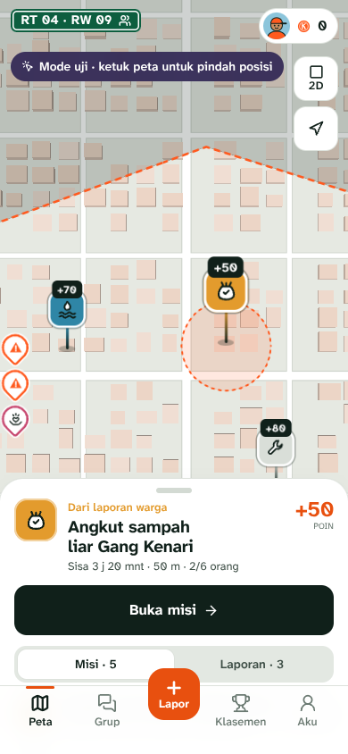
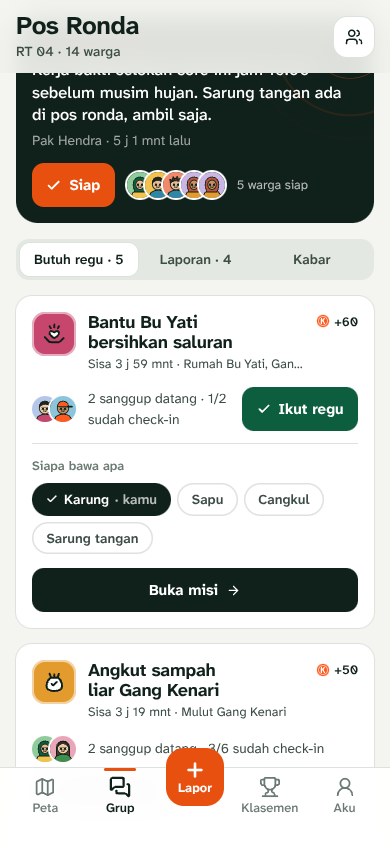
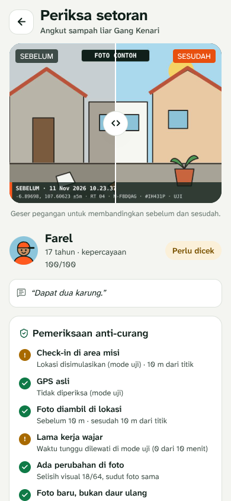
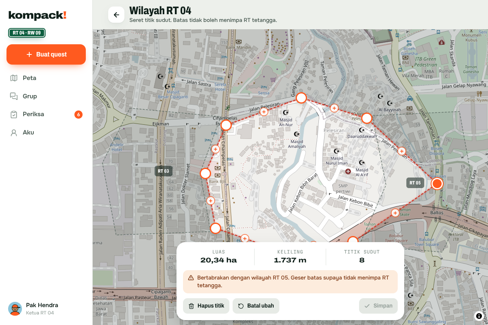

# Kompack! — Gotong Royong Acknowledgment

Kerja bakti jadi misi di peta 3D RT-mu. Purwarupa hackathon tim **Batak Intelligence** (Case 2: Stronger Communities and Everyday Services).

| Peta (2D, bisa 3D) | Pos Ronda | Anti-curang | Wilayah RT |
|---|---|---|---|
|  |  |  |  |

## Cara mencoba

| Platform | Cara |
|---|---|
| **Android** | Pasang `release/kompack.apk` (APK debug, izinkan "sumber tidak dikenal"). |
| **Web / PC** | `npm install` lalu `npm run dev` → buka http://localhost:5173 |
| **Desktop (Rust/Tauri)** | `npm run desktop:dev` atau `npm run desktop:build` (butuh Rust; di Linux juga `libwebkit2gtk-4.1-dev`) |

Di PC pilih **"Coba di PC (mode uji)"** saat pendaftaran: posisi dipindah dengan mengetuk peta, foto contoh boleh dipakai bila tak ada webcam, dan waktu tunggu bisa dilewati. Semua setoran mode uji ditandai untuk Ketua RT.

Untuk mencoba sisi Ketua RT: **Aku → Masuk sebagai Ketua RT** (akun demo Pak Hendra). Buka dua jendela browser untuk melihat warga dan RT berjalan bersamaan.

Kamera dan GPS browser butuh `localhost` atau HTTPS.

## Alur

1. Warga **melapor** (sampah, selokan, fasilitas rusak) atau **minta tolong**, dengan foto kamera di lokasi, di dalam wilayah RT-nya.
2. Warga lain jadi **saksi**. Ketua RT meninjau lalu **menjadikannya misi** (pelapor +10 poin, dan tidak boleh mengerjakan laporannya sendiri).
3. Warga check-in di lokasi, foto sebelum, bekerja minimal N menit, foto sesudah, lalu kirim.
4. Ketua RT memeriksa dengan panel anti-curang, menyetujui, dan poin masuk. Poin menaikkan pangkat, klasemen RT, dan lomba antar-RT.

**Pos Ronda** menggantikan grup obrolan: tidak ada kolom chat. Warga merespons dengan aksi (saksi, gabung regu, sanggup bawa alat), dan hanya pengurus yang bisa memukul **kentongan** untuk memanggil warga.

## Anti-curang

| Celah | Penangkal |
|---|---|
| GPS palsu | Plugin native Android membaca flag mock location dan menolak check-in; lompatan posisi > 40 m/detik memblokir 3 menit; akurasi > 40 m ditolak |
| Foto lama / dari galeri | Hanya kamera di dalam aplikasi; watermark waktu + koordinat dibakar ke foto; segel SHA-256 |
| Foto sebelum = sesudah | Sidik visual dHash dibandingkan; terlalu mirip → tidak bisa dikirim |
| Foto dipakai ulang | Dicocokkan dengan semua foto lain di RT |
| Setoran kilat | Waktu kerja minimal per misi dengan hitung mundur |
| Lapor lalu kerjakan sendiri | Pelapor diblokir dari misi hasil laporannya |
| Farming | Maks. 4 misi dan 3 laporan per hari, satu misi aktif dalam satu waktu |
| RT menyetujui diri sendiri | Ketua RT tidak ikut misi dan tidak bisa memeriksa setorannya |
| Misi/laporan di luar wilayah | Wilayah RT berupa poligon; area check-in harus muat di dalamnya; batas RT tidak boleh menimpa tetangga |

Aturannya ada di `src/lib/integrity.ts` dan `src/lib/store.ts`.

**Batasan purwarupa:** data masih tersimpan di perangkat (IndexedDB), warga lain adalah data contoh, dan pemeriksaan berjalan di klien. Untuk produksi, fungsi di `integrity.ts` perlu dijalankan ulang di server (Supabase/Firebase) supaya klien yang dimodifikasi tidak bisa memberi poin sendiri.

## Teknologi

React 19 + Vite + TypeScript · MapLibre GL (peta vektor 3D, ubin OpenFreeMap, cadangan otomatis ke ubin OpenStreetMap) · Zustand + IndexedDB · Motion · Capacitor 8 (Android) · Tauri 2 / Rust (desktop) · PWA.

```
src/lib/         data, aturan, geometri wilayah, anti-curang
src/components/  peta 3D, kamera bukti, tombol tahan, UI
src/screens/     peta, misi, lapor, pos ronda, klasemen, aku, rt/*
android/         proyek Capacitor + IntegrityPlugin.java
src-tauri/       pembungkus desktop Rust
```

Build APK: `npm run android:apk` (butuh Android SDK + JDK 21).
