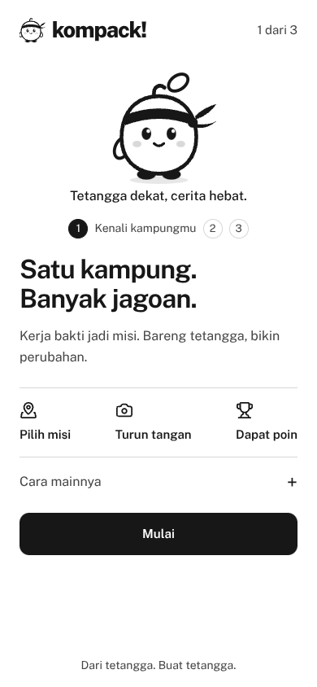
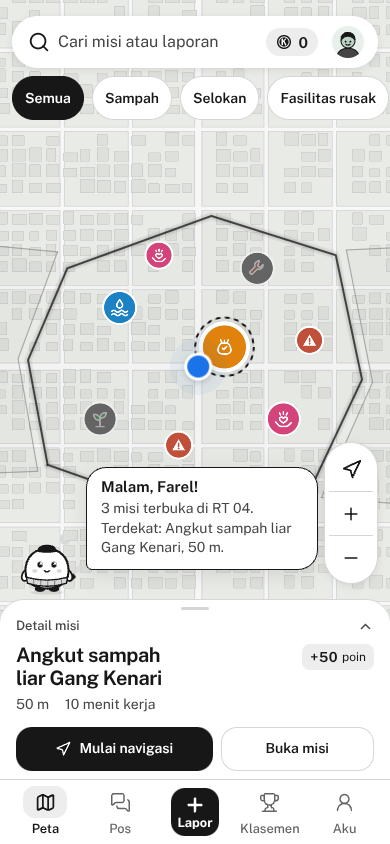
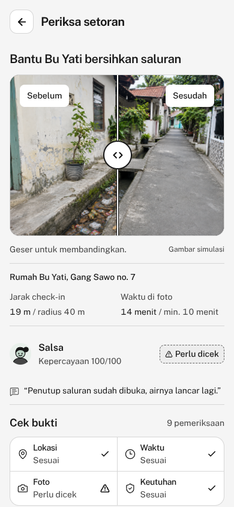

# Kompack! — Gotong Royong Acknowledgment

Kerja bakti jadi misi di peta lingkunganmu. Purwarupa hackathon tim **Batak Intelligence** (Case 2: Stronger Communities and Everyday Services).

| Mulai | Peta ringkas | Periksa bukti |
|---|---|---|
|  |  |  |

Tampilan bawaan hitam-putih dengan Public Sans; aksen Kampung (hijau) / Laut (biru) bisa dipilih di **Aku → Pengaturan**. Warna hanya ada di isi: peta 2D berwarna ala Google Maps, titik GPS biru, dan satu warna per kategori misi.

**Warga Kompack!** — keluarga karakter hitam-putih ala Duolingo. **Kompi** (maskot utama, ikat kepala kerja bakti) ada di logo, ikon aplikasi, dan pendaftaran. **Resik** (kebersihan), **Tunas** (taman), dan **Asih** (bantuan) memberi saran di halaman misi/lapor dan ikut girang saat setoranmu disetujui. **Jaga** khusus ronda malam: menyapa di Pos Ronda dan saat aplikasi dibuka malam hari. Semua karakter bisa diketuk dan melambai balik.

**Pekan beruntun & target pekanan:** dihitung hanya dari aksi yang sudah diterima Ketua RT, jadi tidak bisa dipancing sendiri. Tampil di chip poin peta dan halaman **Aku**. Screenshot peta di atas memakai data jalan sintetis karena server ubin terblokir di jaringan cloud; aplikasi sungguhan memakai data geografis OpenFreeMap/OpenStreetMap.

## Cara mencoba

**Windows lokal, sekali klik:** unduh [Kompack-Windows.zip](release/Kompack-Windows.zip), ekstrak, lalu klik **Install-Kompack.cmd**. Runtime Node dan setup HTTPS sudah disertakan. Paket memasang aplikasi ke G:\Hackathon\Kompack! dan membuka browser setelah server siap. [Panduan HP dan HTTPS](docs/LOCAL-WINDOWS.md).

| Platform | Cara |
|---|---|
| **Android** | Pasang `release/kompack.apk` (build debug terbaru), atau jalankan `npm run android:apk`. |
| **Web / PC** | Node ≥22.12; `npm ci` lalu `npm run dev` → buka http://localhost:5173 |
| **Desktop (Rust/Tauri)** | `npm run desktop:dev` atau `npm run desktop:build` (butuh Rust; di Linux juga `libwebkit2gtk-4.1-dev`) |

Di PC pilih **"Coba di PC (mode uji)"** saat pendaftaran: posisi tetap memakai GPS (atau titik rumah bila tidak ada GPS); mengetuk peta tidak memindahkan posisimu. Untuk mencoba tanpa berjalan, pakai **Jalan otomatis** saat navigasi atau **pindah ke lokasi misi** di halaman misi. Foto contoh boleh dipakai bila tak ada webcam, dan waktu tunggu bisa dilewati. Semua setoran mode uji ditandai untuk Ketua RT.

Untuk mencoba sisi Ketua RT: **Aku → Masuk sebagai Ketua RT** (akun demo Pak Hendra). Buka dua jendela browser untuk melihat warga dan RT berjalan bersamaan.

Kamera dan GPS browser butuh `localhost` atau HTTPS.

Foto contoh baru adalah gambar simulasi yang dibuat untuk demo, ditandai di luar foto. Bukti yang sudah tersimpan tetap dipertahankan. Untuk mencoba data contoh baru pada instalasi lama, gunakan profil browser baru; **Aku → Hapus data** juga tersedia jika seluruh data lokal memang ingin dihapus.

## Peta dan navigasi

Pilih misi di peta lalu tekan **Mulai navigasi**. Navigasi jalan kaki berjalan sepenuhnya di dalam aplikasi, tanpa membuka Google Maps:

- banner belokan di atas (ikon, jarak ke belokan, nama jalan, dan "Lalu…" untuk belokan berikutnya);
- kamera mengikuti posisimu dengan arah jalan di atas, posisimu tampil sebagai panah;
- bagian jalur yang sudah dilewati berubah abu-abu, potongan di luar jalan (dari posisimu ke jalan, dari jalan ke titik misi) digambar putus-putus;
- panel bawah berisi sisa waktu, jarak, jam tiba, dan daftar semua langkah;
- suara petunjuk berbahasa Indonesia (bisa dimatikan), tombol **Pusatkan ulang** setelah peta digeser, cari ulang rute otomatis saat keluar jalur;
- layar **Kamu sudah sampai** dengan tombol **Mulai misi di sini**.

Rute diambil dari layanan Valhalla (`valhalla1.openstreetmap.de`). Bila layanan itu tidak terjangkau, aplikasi menghitung rute **di perangkat** dari data jalan OpenStreetMap yang sudah termuat di peta (`src/lib/localRoute.ts`): ruas dipecah di setiap persilangan, lalu dicari jalur terpendek. Jalurnya selalu mengikuti jalan yang terpetakan, tidak pernah garis lurus menembus rumah. Bila data jalan belum termuat (tanpa internet sama sekali), aplikasi menjelaskannya dan menawarkan **Coba lagi**.

GPS simulasi, tidak akurat, atau kedaluwarsa tidak mengonfirmasi kedatangan. Di **mode uji** (PC), tombol **Jalan otomatis** menggerakkan posisimu sepanjang rute supaya alur navigasi bisa dicoba tanpa berjalan; check-in misi tetap memakai aturannya sendiri dan ditandai sebagai uji.

Validasi: `npm run test:routing` (11 tes: parser Valhalla, proyeksi GPS, rute perangkat yang mengikuti jalan, belokan bernama, titik di luar jangkauan, jarak ke belokan berikutnya).

## Alur

1. Warga **melapor** (sampah, selokan, fasilitas rusak) atau **minta tolong**, dengan foto kamera di lokasi, di dalam wilayah RT-nya.
2. Warga lain jadi **saksi**. Ketua RT meninjau lalu **menjadikannya misi** (pelapor +10 poin, dan tidak boleh mengerjakan laporannya sendiri).
3. Warga check-in di lokasi, foto sebelum, bekerja minimal N menit, foto sesudah, lalu kirim.
4. Ketua RT memeriksa dengan panel anti-curang, menyetujui, dan poin masuk. Poin menaikkan pangkat, klasemen RT, dan lomba antar-RT.

**Pos Ronda** menggantikan grup obrolan: tidak ada kolom chat. Warga merespons dengan aksi (saksi, gabung regu, sanggup bawa alat), dan hanya pengurus yang bisa memukul **kentongan** untuk memanggil warga.

## Anti-curang

| Celah | Penangkal |
|---|---|
| GPS palsu | Plugin native Android membaca flag mock location dan menolak check-in; lompatan posisi > 40 m/detik memblokir 3 menit; akurasi > 40 m ditolak |
| Foto lama / dari galeri | Hanya kamera di dalam aplikasi; watermark waktu + koordinat dibakar ke foto; segel SHA-256 |
| Foto sebelum = sesudah | Sidik visual dHash dibandingkan; terlalu mirip → tidak bisa dikirim |
| Foto dipakai ulang | Dicocokkan dengan semua foto lain di RT |
| Setoran kilat | Waktu kerja minimal per misi dengan hitung mundur |
| Lapor lalu kerjakan sendiri | Pelapor diblokir dari misi hasil laporannya |
| Farming | Maks. 4 misi dan 3 laporan per hari, satu misi aktif dalam satu waktu |
| RT menyetujui diri sendiri | Ketua RT tidak ikut misi dan tidak bisa memeriksa setorannya |
| Misi/laporan di luar wilayah | Wilayah RT berupa poligon; area check-in harus muat di dalamnya; batas RT tidak boleh menimpa tetangga |

Aturannya ada di `src/lib/integrity.ts` dan `src/lib/store.ts`.

**Mode lokal bersama:** server PC menyimpan data di `.kompack/world.json`, menjalankan aturan misi dan pemeriksaan bukti, serta mengirim perubahan ke browser anggota lewat Server-Sent Events. Perangkat pertama menjadi pemilik akun demo RT, anggota berikutnya memakai ID warga berbeda. Kuota dan perubahan data diproses berurutan, sehingga slot dan poin tidak dihitung dua kali. Data awal tetap berisi warga/misi contoh.

**Mode standalone:** `npm run dev` tanpa server lokal tetap memakai IndexedDB dan sinkron antartab browser yang sama. Untuk penggunaan publik, mode server lokal perlu dilengkapi autentikasi akun produksi dan pemeriksaan provenance foto/GPS di luar input klien.

## Teknologi

React 19 + Vite + TypeScript · MapLibre GL (peta vektor 2D ala Google Maps, ubin OpenFreeMap, cadangan otomatis ke ubin OpenStreetMap) · Zustand + IndexedDB · Motion · Capacitor 8 (Android) · Tauri 2 / Rust (desktop) · PWA.

```
src/lib/         data, aturan, geometri wilayah, anti-curang
src/components/  peta 2D, karakter (KampungBuddy), kamera bukti, tombol tahan, UI
src/screens/     peta, misi, lapor, pos ronda, klasemen, aku, rt/*
android/         proyek Capacitor + IntegrityPlugin.java
src-tauri/       pembungkus desktop Rust
```

Build APK: `npm run android:apk` (butuh Android SDK + JDK 21).
